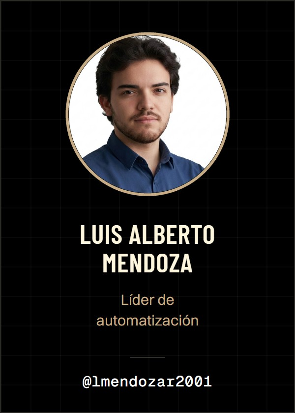
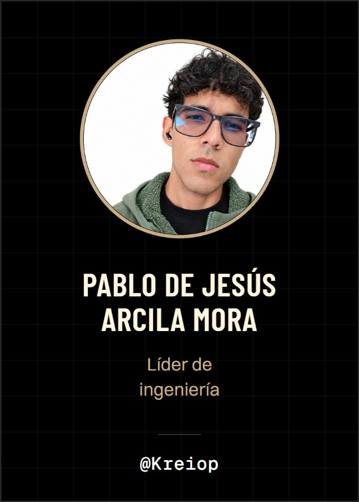
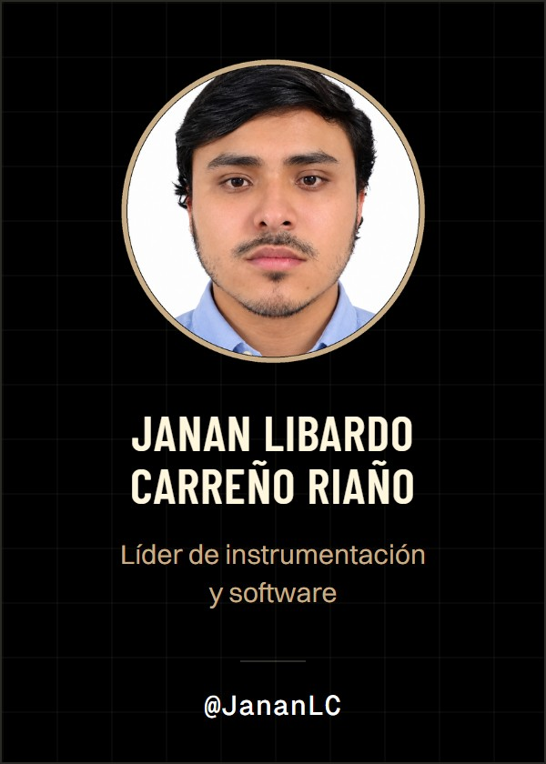

  

**Mekvra S.A.S** es una empresa integradora de soluciones de **Transformación Digital Industrial**, formada por cinco ingenieros mecatrónicos de la Universidad Nacional de Colombia. Conectamos el proceso físico con la gestión del negocio: instrumentación, control, robótica, SCADA, gemelos digitales, MES y ERP, sobre los estándares ISA-95 e ISA-88.

Nuestro proyecto actual es la automatización de **Lácteos Altos de Teusacá**, una planta de derivados lácteos en Zipaquirá que recibe 150.000 L de leche al día en tres líneas: yogurts, quesos y leche UHT.

### Proyecto

| | |
|:--|:--|
| **Página web** | [mekvra.github.io/proyecto-integrador](https://mekvra.github.io/proyecto-integrador/) |
| **Repositorio de ingeniería** | [Mekvra/proyecto-integrador](https://github.com/Mekvra/proyecto-integrador) |
| **Curso** | Automatización de Procesos de Manufactura · 2026-2S · UNAL Sede Bogotá |

### Equipo

  
  
  
  
  

